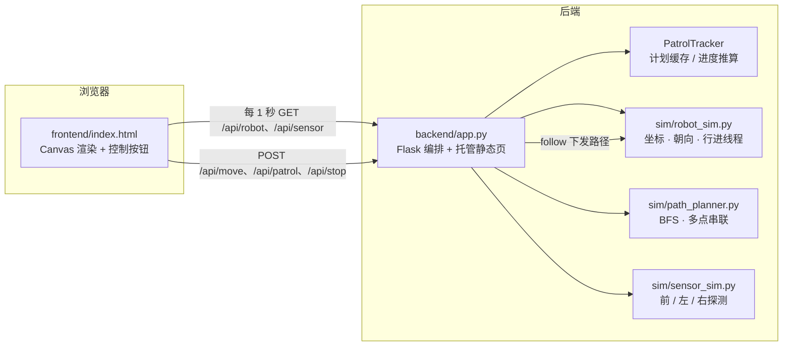

# 03 项目架构与接口

> 本文档以仓库现有代码为准（`backend/app.py`、`frontend/index.html`、`backend/sim/*`），字段名、错误文案、状态流转逐条对照实现，并已在本地实跑六个接口验证。改接口须同时改代码与本文件。

## 1. 仓库范围与交付状态

| 文件 | 责任人 | 状态 |
|---|---|---|
| `backend/app.py` | 全栈 | 已实现 |
| `frontend/index.html` | 全栈 | 已实现 |
| `backend/sim/robot_sim.py` | 嵌入式仿真 | 已入库，与契约一致 |
| `backend/sim/path_planner.py` | 算法 | 已入库，与契约一致 |
| `backend/sim/sensor_sim.py` | 人工智能 | 已入库，与契约一致 |
| `backend/sim/__init__.py` | 模板要求 | 已入库 |
| `Dockerfile`、`docker-compose.yml`、`.github/workflows/ci.yml` | 运维 | 未入库 |
| `docs/01`、`docs/02`、`docs/04`、三份 `AGENTS.md` | 运维 / 全组 | 未入库 |

`python backend/app.py` 可直接启动，六个接口全部可用。

## 2. 架构图



`app.py` 只做编排：收请求、校验入参、调模块、拼响应。业务逻辑一律在 `sim/` 里。

## 3. 运行事实

| 项 | 实现 |
|---|---|
| 入口 | `python backend/app.py`；`app.py:19-21` 由 `__file__` 反推根目录，`backend/` 与 `frontend/` 必须同级 |
| 监听 | `HOST` 默认 `0.0.0.0`，`PORT` 默认 `5050`，`threaded=True` |
| 静态托管 | `static_folder=<root>/frontend`、`static_url_path=""`，`GET /` 返回 `index.html` |
| 跨域 | 所有响应带 `Access-Control-Allow-Origin: *`、允许 `Content-Type`、方法 `GET/POST/OPTIONS` |
| 缓存 | 所有响应带 `Cache-Control: no-store`，轮询不会命中旧数据 |
| 依赖 | 仅 `flask>=3.0`，无数据库、无外部服务、无密钥 |

## 4. 数据约定

| 项 | 约定 | 代码位置 |
|---|---|---|
| 坐标原点 | 左上角 `(0, 0)`，x 向右、y 向下递增，单位「格」 | `app.py:27-29` |
| 地图规格 | 20×20，合法坐标 0–19 的整数 | `app.py:27` |
| 起点 | `[0, 0]`，由 `robot_sim.set_map` 注入后初始化 | `app.py:29,40` |
| 障碍物 | 15 格，见下表 | `app.py:32-36` |
| 机器人字段 | `x`、`y`、`angle`（0 右 / 90 下 / 180 左 / 270 上）、`status`（`idle` / `moving` / `finished`） | `robot_sim.get_state()` |
| 巡检点上限 | 6 个 | `app.py:28` |
| 速度 | 四档 `0.5 / 1 / 2 / 4`；1x 时每格 0.4 秒，即 0.5x=0.8s、2x=0.2s、4x=0.1s | `robot_sim.STEP_SECONDS` |
| 状态获取 | 前端每 1 秒轮询 `GET /api/robot` 与 `GET /api/sensor`，不使用 WebSocket | `index.html:653-654` |

障碍物坐标（竖墙 + 横墙 + 三格短墙）：

```
[6,2] [6,3] [6,4] [6,5] [6,6] [6,7] [6,8]
[10,10] [11,10] [12,10] [13,10] [14,10]
[16,4] [16,5] [16,6]
```

## 5. 六个接口

### 5.1 `GET /api/map`

成功 200：

```json
{
  "size": 20,
  "obstacles": [[6, 2], [6, 3], "..."],
  "start": [0, 0],
  "max_patrol_points": 6
}
```

前端启动时请求一次，用它设置画布尺寸、障碍格与巡检点上限。

### 5.2 `GET /api/robot`

成功 200，即 `robot_sim.get_state()` 原样返回：

```json
{"x": 0, "y": 0, "angle": 0, "status": "idle"}
```

副作用：后端用 `(x, y)` 推进巡检进度游标（见 5.7）。

### 5.3 `POST /api/move`

请求：

```json
{"direction": "up"}
```

| 情况 | 状态码 | 响应 `msg` |
|---|---|---|
| 移动成功 | 200 | — （`{"ok": true}`） |
| 目标格越界 | 409 | `越界：目标格 (x, y) 超出 0-19 范围，移动被阻止` |
| 目标格是障碍 | 409 | `碰撞：目标格 (x, y) 为障碍物，移动被阻止` |
| 方向不合法 | 409 | `方向参数无效：只接受 up/down/left/right` |
| 巡检进行中 | 409 | `巡检进行中，请先调用 stop() 停止任务再手动控制` |

失败时坐标不变。前端按文案分流（`index.html:561`）：`msg` 含「障碍」→ 碰撞告警，否则 → 越界告警。巡检中的手动指令需先调用 `/api/stop`。

### 5.4 `POST /api/patrol`

请求：

```json
{"points": [[3, 4], [15, 5]], "speed": 1}
```

校验顺序（任何一步失败即 409）：

| 顺序 | 条件 | 状态码 | `msg` |
|---|---|---|---|
| 1 | `points` 元素不是二元可转整数的数组 | 409 | `巡检点格式应为 [[x, y], ...]` |
| 2 | 某点超出 0–19 | 409 | `巡检点 (x, y) 越界` |
| 3 | 某点落在障碍物上 | 409 | `巡检点 (x, y) 位于障碍物上` |
| 4 | 去重后为空 | 409 | `请先在地图上点击设置巡检点` |
| 5 | 去重后超过 6 个 | 409 | `巡检点最多 6 个` |
| 6 | 规划结果不足 2 个点 | 409 | `目标点不可达` |

成功 200：

```json
{"ok": true, "plan": [[0, 0], [1, 0], "..."], "unreachable": [], "msg": ""}
```

| 字段 | 说明 |
|---|---|
| `plan` | 完整路径，**首点为机器人当前位置**（后端自动拼接，前端不要重复传） |
| `unreachable` | 被跳过的巡检点，来自 `patrol()` 返回值的 `unreachable_points` 属性 |
| `msg` | 全部可达时为 `""`；部分不可达时为 `部分点位不可达，已跳过：[[x, y]]` |

其他行为：

- `speed` 非数字或 ≤ 0 时按 `1.0` 处理。
- 路径算好后写入进度缓存并调用 `robot_sim.follow(plan, speed)`，后者立即返回，行进在后台线程完成。
- 巡检进行中再次调用会以新计划覆盖上一轮，`follow` 内部先停止旧线程。
- `unreachable` 的说明文案由 `app.py` 拼接，不直接使用 `patrol()` 的 `.msg`。

### 5.5 `POST /api/stop`

无请求体。响应 200：

```json
{"ok": true, "status": "idle"}
```

`status` 为停止后立即读到的机器人状态。`stop()` 不清空进度缓存。

### 5.6 `GET /api/sensor`

成功 200：

```json
{
  "front_blocked": false,
  "left_blocked": true,
  "right_blocked": false,
  "collision": false,
  "out_of_bound": false,
  "progress": {"finished": 0, "total": 2, "remain": 25},
  "target": [3, 4],
  "status": "moving"
}
```

| 字段 | 来源 | 说明 |
|---|---|---|
| `front_blocked` / `left_blocked` / `right_blocked` | `sensor_sim.detect` | 朝向的前、左、右相邻格是否不可通行；越界格也算不可通行 |
| `collision` | `sensor_sim.detect` | 当前坐标恰好落在障碍物上 |
| `out_of_bound` | `sensor_sim.detect` | 当前坐标超出 0–19 |
| `progress.finished` | `PatrolTracker` | 已到达巡检点数 |
| `progress.total` | `PatrolTracker` | 本次巡检点总数；未启动过巡检为 0 |
| `progress.remain` | `PatrolTracker` | 剩余格数（`len(plan) - 1 - 游标`） |
| `target` | `PatrolTracker` | 当前目标巡检点，无任务或已全部到达为 `null` |
| `status` | `sensor_sim` / `get_state()` | 与 `/api/robot` 一致，供前端直接渲染 |

左右判定：前方单位向量 `f=(dx,dy)`，左手为 `(x+dy, y-dx)`、右手为 `(x-dy, y+dx)`；朝右（angle 0）时左手在上、右手在下。

`sensor_sim.detect` 遇到非法输入（state 缺字段、坐标不可转整数、size 非正）时，五个布尔值均为 `false` 并额外带 `msg`，不抛异常。

### 5.7 进度推算口径（`PatrolTracker`）

- 计划路径在 `/api/patrol` 成功时缓存；`/api/robot` 与 `/api/sensor` 每次都用当前坐标把游标向前推进到 `plan` 中该坐标所在下标。
- `finished`：`total` 中「在 `plan` 里最后出现的位置 ≤ 游标」的巡检点数。
- `target`：`total` 中第一处「最后出现位置 > 游标」的巡检点。
- 游标只前进不后退，`/api/stop` 不清空缓存。

## 6. 错误约定

| 场景 | 状态码 | 响应体 |
|---|---|---|
| 移动被边界、障碍、方向或巡检状态拦截 | 409 | `{"ok": false, "msg": "具体原因"}` |
| 巡检点越界 / 在障碍上 / 格式错误 / 超过 6 个 / 全部不可达 | 409 | `{"ok": false, "msg": "原因"}` |
| 部分巡检点不可达 | 200 | `{"ok": true, ..., "unreachable": [...], "msg": "已跳过说明"}` |
| 请求体不是合法 JSON | 按空对象处理 | 走后续校验（通常 409） |
| 后端未启动 | 无响应 | 前端状态栏显示「后端连接中断」 |

前端把失败分成三类弹窗：「碰撞告警」「越界告警」「任务提示」，4.2 秒后自动消失，也可点 ✕ 关闭。

## 7. 内部契约（已实现版本）

```python
# backend/sim/robot_sim.py
robot_sim.set_map(obstacles=None, size=20)   # 注入地图与起点，app.py:40 调用一次
robot_sim.move(direction)  -> dict            # {"ok": True} / {"ok": False, "msg": 原因}
robot_sim.get_state()      -> dict            # {"x": int, "y": int, "angle": int, "status": str}
robot_sim.follow(points, speed=1) -> None     # 后台线程逐格行进，调用即返回
robot_sim.stop()           -> None            # 置 idle，并等待线程退出
robot_sim.set_start(x=0, y=0, angle=0) -> None  # 复位起点，app.py 未使用，供测试
robot_sim.get_last_report() -> dict             # 上一次行进的统计，app.py 未使用

# backend/sim/path_planner.py
path_planner.bfs(size, obstacles, start, end) -> dict
    # {"ok": True,  "path": [[x, y], ...], "msg": ""}
    # {"ok": False, "path": [],            "msg": "无法找到路径" / "起点坐标越界" / "终点坐标越界"}
path_planner.patrol(size, obstacles, points)  -> PatrolPath
    # PatrolPath 是 list 子类，本体即 [[x, y], ...] 完整路径
    # 额外属性：.unreachable_points（被跳过的巡检点）、.msg（说明文字）

# backend/sim/sensor_sim.py
sensor_sim.detect(state, obstacles, size=20) -> dict
    # {"front_blocked": bool, "left_blocked": bool, "right_blocked": bool,
    #  "collision": bool, "out_of_bound": bool}
    # 输入非法时五个字段为 False，并追加 "msg"
```

行为细节：

- `robot_sim.move` 在 `finished` 状态下先回到 `idle` 再移动；`moving` 状态下直接拒绝。
- `robot_sim.follow` 按 `STEP_SECONDS / speed` 决定每格间隔，结束时置 `finished`；被 `stop()` 打断则置 `idle`。
- `path_planner.patrol` 以 `points[0]` 为路径起点，逐段调用 `bfs` 并去掉每段首点后拼接；某点不可达则跳过并记入 `unreachable_points`，不影响其余点。
- `sensor_sim` 的「不可通行」包括越出地图与落在障碍物上；机器人自身越界时仍按几何给出三向读数。

## 8. 前端消费口径

| 行为 | 实现 |
|---|---|
| 加载 | 启动时 `GET /api/map` 取尺寸、障碍物、巡检点上限 |
| 轮询 | `setInterval(poll, 1000)` 并发请求 `/api/robot` + `/api/sensor`；上一轮未返回时跳过本轮 |
| 轨迹 | 路径与游标由前端自行用 `plan` 与机器人坐标推算，不依赖后端下发下标 |
| 速度 | 滑块 0–3 对应 `0.5 / 1 / 2 / 4`，仅在启动巡检时随请求下发；改滑块不会重发请求 |
| 巡检点 | 点击画布添加；点同一格移除；障碍格拒绝并提示；上限取 `/api/map` 的 `max_patrol_points` |
| 状态卡 | 坐标 / 运动状态 / 传感器状态 / 最近告警 / 巡检进度（`finished / total` + 剩余步数） |
| 手动按键 | 方向键与按钮发 `/api/move`，成功后立即拉一次轮询 |

## 9. 已知边界

- 巡检进行中点击方向键会收到「巡检进行中」的 409，前端弹任务提示，需先点停止。
- 刷新页面后前端丢失 `plan`，轨迹不再绘制，直到重新启动巡检；后端游标仍在。
- 巡检结束后 `progress` 保留上一次结果，`/api/stop` 与前端「清空巡检点」不清空，直到下次巡检覆盖。
- 机器人巡检结束后手动移动，`status` 回到 `idle`，但 `progress` 仍显示上一轮的完成数。
- `finished` 依赖坐标是否出现在 `plan` 中，`remain` 只按游标计算，手动挪离路径后可能偏大。

## 10. 变更规则

- 接口字段、错误文案、障碍物坐标的任何改动，必须同时改 `app.py`、`index.html`、本文件，并在 PR 里写明。
- 新增接口须同步更新第 5 节与本文件顶部说明；不允许只改代码不改文档。
- 三个 `sim` 模块的对外函数签名视为冻结，改动须全员同意。
