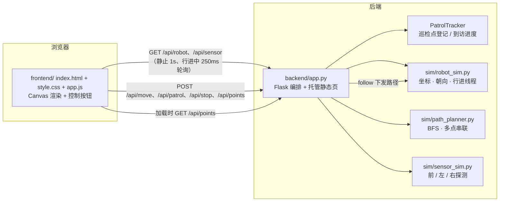

# 03 项目架构与接口

> 本文档以仓库现有代码为准（`backend/app.py`、`frontend/`（`index.html` + `style.css` + `app.js`）、`backend/sim/*`），字段名、错误文案、状态流转逐条对照实现，并已在本地实跑九个接口验证。改接口须同时改代码与本文件。

## 1. 仓库范围与交付状态

| 文件 | 责任人 | 状态 |
|---|---|---|
| `backend/app.py` | 全栈 | 已实现 |
| `frontend/`（`index.html` / `style.css` / `app.js`） | 全栈 | 已实现 |
| `backend/sim/robot_sim.py` | 嵌入式仿真 | 已入库，与契约一致 |
| `backend/sim/path_planner.py` | 算法 | 已入库，与契约一致 |
| `backend/sim/sensor_sim.py` | 人工智能 | 已入库，与契约一致 |
| `backend/sim/__init__.py` | 模板要求 | 已入库 |
| `Dockerfile`、`docker-compose.yml`、`.github/workflows/ci.yml` | 运维 | 未入库 |
| `docs/01`、`docs/02`、`docs/04`、三份 `AGENTS.md` | 运维 / 全组 | 未入库 |

`python backend/app.py` 可直接启动，九个接口全部可用。

## 2. 架构图



`app.py` 只做编排：收请求、校验入参、调模块、拼响应。业务逻辑一律在 `sim/` 里。

## 3. 运行事实

| 项 | 实现 |
|---|---|
| 入口 | `python backend/app.py`；`app.py:19-21` 由 `__file__` 反推根目录，`backend/` 与 `frontend/` 必须同级 |
| 监听 | `HOST` 默认 `0.0.0.0`，`PORT` 默认 `5050`，`threaded=True` |
| 静态托管 | `static_folder=<root>/frontend`、`static_url_path=""`，`GET /` 返回 `index.html`；`/style.css`、`/app.js`、`/test/*` 走 Flask 静态路由 |
| 跨域 | 所有响应带 `Access-Control-Allow-Origin: *`、允许 `Content-Type`、方法 `GET/POST/OPTIONS` |
| 缓存 | 所有响应带 `Cache-Control: no-store`，轮询不会命中旧数据 |
| 依赖 | 仅 `flask>=3.0`，无数据库、无外部服务、无密钥 |

## 4. 数据约定

| 项 | 约定 | 代码位置 |
|---|---|---|
| 坐标原点 | 左上角 `(0, 0)`，x 向右、y 向下递增，单位「格」 | `app.py:27-29` |
| 地图规格 | 20×20，合法坐标 0–19 的整数 | `app.py:27` |
| 起点 | `[0, 0]`，由 `robot_sim.set_map` 注入后初始化 | `app.py:29,40` |
| 障碍物 | 15 格，见下表 | `app.py:32-36` |
| 机器人字段 | `x`、`y`、`angle`（0 右 / 90 下 / 180 左 / 270 上）、`status`（`idle` / `moving` / `finished`） | `robot_sim.get_state()` |
| 巡检点上限 | 6 个 | `app.py:28` |
| 速度 | 四档 `0.5 / 1 / 2 / 4`；1x 时每格 0.4 秒，即 0.5x=0.8s、2x=0.2s、4x=0.1s。注意 1x 不等于「1 格/秒」，实际约 2.5 格/秒 | `robot_sim.STEP_SECONDS` |
| 状态获取 | 前端自适应轮询 `GET /api/robot` 与 `GET /api/sensor`：静止 1 秒一次，行进中 250 毫秒一次，不使用 WebSocket | `app.js` 的 `pollTick()` |
| 进度推进 | 后端后台采样线程每 0.1 秒把机器人坐标喂给 `PatrolTracker`，`GET` 接口不再产生副作用 | `app.py` 的 `_watch_loop` |

障碍物坐标（竖墙 + 横墙 + 三格短墙）：

```
[6,2] [6,3] [6,4] [6,5] [6,6] [6,7] [6,8]
[10,10] [11,10] [12,10] [13,10] [14,10]
[16,4] [16,5] [16,6]
```

## 5. 九个接口

### 5.1 `GET /api/map`

成功 200：

```json
{
  "size": 20,
  "obstacles": [[6, 2], [6, 3], "..."],
  "start": [0, 0],
  "max_patrol_points": 6
}
```

前端启动时请求一次，用它设置画布尺寸、障碍格与巡检点上限。

### 5.2 `GET /api/robot`

成功 200，即 `robot_sim.get_state()` 原样返回：

```json
{"x": 0, "y": 0, "angle": 0, "status": "idle"}
```

副作用：后端用 `(x, y)` 记录到访巡检点并推进自动巡检游标（见 5.9）。

### 5.3 `POST /api/move`

请求：

```json
{"direction": "up"}
```

| 情况 | 状态码 | 响应 `msg` |
|---|---|---|
| 移动成功 | 200 | — （`{"ok": true}`） |
| 目标格越界 | 409 | `越界：目标格 (x, y) 超出 0-19 范围，移动被阻止` |
| 目标格是障碍 | 409 | `碰撞：目标格 (x, y) 为障碍物，移动被阻止` |
| 方向不合法 | 409 | `方向参数无效：只接受 up/down/left/right` |
| 巡检进行中 | 409 | `巡检进行中，请先停止任务再手动控制` |

失败时坐标不变。前端按文案分流（`app.js` 的 `move()`）：「巡检进行中」→ 任务提示（文案已是面向用户的「请先点击「停止任务」再手动控制」，前端仍保留旧版「请先调用 stop()」的兜底改写），不向用户暴露接口名；含「障碍」→ 碰撞告警；其余 → 越界告警。

### 5.4 `POST /api/patrol`

请求：

```json
{"points": [[3, 4], [15, 5]], "speed": 1}
```

校验顺序（任何一步失败即 409）：

| 顺序 | 条件 | 状态码 | `msg` |
|---|---|---|---|
| 1 | `points` 元素不是二元可转整数的数组 | 409 | `巡检点格式应为 [[x, y], ...]` |
| 2 | 某点超出 0–19 | 409 | `巡检点 (x, y) 越界` |
| 3 | 某点落在障碍物上 | 409 | `巡检点 (x, y) 位于障碍物上` |
| 4 | 去重后为空 | 409 | `请先在地图上点击设置巡检点` |
| 5 | 去重后超过 6 个 | 409 | `巡检点最多 6 个` |
| 6 | 规划结果不足 2 个点 | 409 | `目标点不可达` |
| 7 | `speed` 不是数字 | 409 | `speed 应为数字` |
| 8 | `speed` 不在 `0.5 / 1 / 2 / 4` 之列 | 409 | `速度只支持 0.5 / 1 / 2 / 4` |

成功 200：

```json
{"ok": true, "plan": [[0, 0], [1, 0], "..."], "unreachable": [], "points": [[3, 4]], "msg": ""}
```

| 字段 | 说明 |
|---|---|
| `plan` | 完整路径，**首点为机器人当前位置**（后端自动拼接，前端不要重复传） |
| `unreachable` | 被跳过的巡检点，来自 `patrol()` 返回值的 `unreachable_points` 属性 |
| `points` | 实际登记进进度口径的点位（只含路径真会经过的点）；与请求体可能不同 |
| `msg` | 全部可达时为 `""`；部分不可达时为 `部分点位不可达，已跳过：[[x, y]]` |

其他行为：

- `speed` 严格校验：非数字 409 `speed 应为数字`，非四档 409 `速度只支持 0.5 / 1 / 2 / 4`（与 `POST /api/speed` 完全一致，早期版本这里会静默回退成 1.0）。
- 路径算好后写入进度缓存并调用 `robot_sim.follow(plan, speed)`，后者立即返回，行进在后台线程完成。
- 只有路径真会经过的点位才登记进 `PatrolTracker`（`counted_points`）；不可达点补齐进 `unreachable` 并在响应里回 `points`，避免 `total` 永远达不到。
- 巡检进行中再次调用会以新计划覆盖上一轮，`follow` 内部先停止旧线程。
- `unreachable` 的说明文案由 `app.py` 拼接，不直接使用 `patrol()` 的 `.msg`。

### 5.5 `GET /api/points` / `POST /api/points`

巡检点登记接口：只记点位、不启动移动，使手动操作也能推进进度。

**GET** 成功 200：

```json
{"ok": true, "points": [[3, 4], [15, 5]]}
```

前端页面加载时请求一次，恢复上次登记的巡检点（刷新不丢点）。

**POST** 请求：

```json
{"points": [[3, 4], [15, 5]]}
```

校验与 5.4 第 1–3、5 条完全一致（两处共用 `_clean_points`）：格式错误 / 越界 / 落在障碍物上 / 去重后超过 6 个，均返回 409 与对应 `msg`。空数组合法，表示清空巡检点与进度。

成功 200：

```json
{"ok": true, "points": [[3, 4], [15, 5]]}
```

其他行为：

- 覆盖式登记：以请求体为准，不做追加；`points` 省略或为空数组即清空。
- **巡检进行中（`status === "moving"` 且有 `plan`）返回 409 `巡检进行中，请先停止巡检再修改巡检点`**：早期版本允许行进中改点，会导致 `total` 变化而 `finished` 追不上、进度永远卡住。
- 不在新集合中的点位，其到访记录同步丢弃；仍存在的点位保留原「已到访」状态，改点位不会把已有进度清零。
- 进度按新列表做**前缀匹配重算**（`set_points()`）：把已计入的点位序列与新列表从头逐个比对，能对上的保留，从第一个对不上的位置起清零。效果是「末尾追加点位保进度、删掉已计入的点位从该处回退」。
  - 例：已计入 P1、P2 后追加 P3 → `2 / 3`；
  - 例：已计入 P1、P2 后删掉 P1 → 序列比对在首位就失配 → `0 / 2`（重算不会凭空保留进度，避免早期「删点后 2/3 变 2/2」的虚高）。
- 不清空 `plan`（停止巡检后 `plan` 仍保留），但只有 `moving` 时才做游标补偿。

### 5.6 `POST /api/stop`

无请求体。响应 200：

```json
{"ok": true, "status": "idle"}
```

`status` 为停止后立即读到的机器人状态。`stop()` 不清空进度缓存，清空巡检点请调用 `POST /api/points`（传空数组）。

### 5.7 `POST /api/reset`

无请求体。响应 200：

```json
{"ok": true, "status": "idle",
 "robot": {"x": 0, "y": 0, "angle": 0, "status": "idle"},
 "points": []}
```

行为：

- 先 `robot_sim.stop()` 终止行进线程；
- `robot_sim.set_start(0, 0, 0)` 把机器人放回起点（`app.py` 的 `START`），朝向回到 0（右）；
- `PatrolTracker.clear()` 清空计划、巡检点与到访记录，进度回到 `0 / 0`；
- 与 5.6 的区别：`stop` 只停行进、保留点位与进度；`reset` 是一次性回到初始状态。
- 前端「复位机器人」按钮调用本接口，点完前端同时清掉本地 `plan` 与告警卡。

### 5.8 `GET /api/sensor`

成功 200：

```json
{
  "front_blocked": false,
  "left_blocked": true,
  "right_blocked": false,
  "collision": false,
  "out_of_bound": false,
  "progress": {"finished": 0, "total": 3, "remain": 0, "mode": "manual"},
  "visited": [[3, 4]],
  "out_of_order": [[3, 4]],
  "target": [10, 2],
  "status": "idle"
}
```

| 字段 | 来源 | 说明 |
|---|---|---|
| `front_blocked` / `left_blocked` / `right_blocked` | `sensor_sim.detect` | 朝向的前、左、右相邻格是否不可通行；越界格也算不可通行 |
| `collision` | `sensor_sim.detect` | 当前坐标恰好落在障碍物上 |
| `out_of_bound` | `sensor_sim.detect` | 当前坐标超出 0–19 |
| `progress.finished` | `PatrolTracker` | 已按登记顺序到达的点位数；乱序到过的点不计入、也不追认（手动、自动同一口径） |
| `progress.total` | `PatrolTracker` | 已登记的巡检点总数；未登记为 0 |
| `progress.remain` | `PatrolTracker` | 自动模式下剩余格数（`len(plan) - 1 - 游标`）；手动模式为 0 |
| `progress.mode` | `PatrolTracker` | `auto` 有计划路径 / `manual` 只有点位 / `idle` 无点位 |
| `visited` | `PatrolTracker` | 所有已到访巡检点坐标，前端用来区分绿色（已计数）与橙色（乱序到访） |
| `out_of_order` | `PatrolTracker` | 已到访但未计入进度的点位（乱序到达、前面还有未到访点），`finished` 为 0 时可能非空 |
| `target` | `PatrolTracker` | 当前该去的巡检点，即 `points[finished]`；无点位或全部到访为 `null` |
| `status` | `sensor_sim` / `get_state()` | 与 `/api/robot` 一致，供前端直接渲染 |

左右判定：前方单位向量 `f=(dx,dy)`，左手为 `(x+dy, y-dx)`、右手为 `(x-dy, y+dx)`；朝右（angle 0）时左手在上、右手在下。

`sensor_sim.detect` 遇到非法输入（state 缺字段、坐标不可转整数、size 非正）时，五个布尔值均为 `false` 并额外带 `msg`，不抛异常。

### 5.9 进度推算口径（`PatrolTracker`）

进度与「谁在移动」无关，只看机器人是否**按登记顺序**走到巡检点：

- 巡检点由 `/api/patrol`（启动自动巡检）或 `/api/points`（手动登记）写入，写入顺序即巡检顺序 P1、P2、P3…
- 进度由后端**后台采样线程** `_watch_loop` 每 0.1 秒调用 `sync(x, y, moving)` 推进（首次 `/api/patrol` 时懒启动，daemon 线程）：坐标命中巡检点就记进 `visited`。`GET /api/robot`、`GET /api/sensor` 已改为纯读、不再有副作用，`/api/move` 仍即时 `sync` 一次，保证快速连按方向键不漏格。
- `finished` = `len(counted)`，`counted` 是「已按顺序到达的点位序列」，**只有当前坐标等于「当前该去的点」时才 append**。先到 P2、P3 而没到 P1 时，`finished` 保持 0。
- 乱序到过的点**不会被追认**：之后补齐 P1、P2，`finished` 只到 2，P3 仍是“未按顺序到达”，必须重新走到 P3 才计入。
- 点位被增删时按新列表做前缀匹配重算（见 5.5），保证 `finished ≤ total` 且不出现虚高。
- `out_of_order` = 已到访但未按顺序计入的点位，前端标橙并弹一次提示；它们不计进度，也不阻塞后续计数。
- `target` = `points[finished]`，即当前按顺序该去的点；无点位或全部到访为 `null`。
- `mode`：有 `plan` 为 `auto`，无 `plan` 但有点位为 `manual`，无点位为 `idle`。
- 自动巡检的路径游标 `cursor` 按 `plan` 单调前进，用于计算 `remain`；**行进中（`moving`）或游标已到路径末端时**，还会用游标做漏采样补偿：游标越过某点位的路径下标即视为按顺序走过。
- 补偿只在机器人 genuinely 行进中生效；`/api/stop` 之后残留的旧 `plan` 不参与推断，手动移动不会被“跳着算”。
- `counted` 里的点位在与新点位列表失配时会被截断（删点回退），`/api/stop` 不清空缓存。

与旧口径的差别：更早的口径算 `visited ∩ 点位集合` 的个数，乱序到访也会 +1；上一版允许“补齐前面的点后追认乱序点”；现口径**既不即时计入、也不追认**，严格按到达顺序推进。

### 5.10 `POST /api/speed`

运行中调整自动巡检速度：不重新规划路径、不重置进度，从机器人当前格按新速度续走。

请求：

```json
{"speed": 2}
```

成功 200：

```json
{"ok": true, "applied": true, "speed": 2.0}
```

| 场景 | 状态码 | 响应体 |
|---|---|---|
| 速度合法且正在巡检 | 200 | `{"ok": true, "applied": true, "speed": 2.0}` |
| 速度合法但没有进行中的巡检 | 200 | `{"ok": true, "applied": false, "speed": 2.0, "msg": "当前没有进行中的巡检，速度已记录，下次启动生效"}` |
| 速度不在 0.5 / 1 / 2 / 4 之列 | 409 | `{"ok": false, "msg": "速度只支持 0.5 / 1 / 2 / 4"}` |
| 当前坐标不在巡检路径上 | 409 | `{"ok": false, "msg": "当前坐标不在巡检路径上，无法调整速度"}` |

实现要点：`robot_sim.follow` 不支持中途改间隔，因此本接口取当前坐标在 `plan` 中的下标，把 `plan[下标:]` 重新交给 `follow`，旧线程由 `follow` 内部停掉后接续；`PatrolTracker` 的 `plan`、`counted`、`visited` 都不动，所以进度与剩余步数连续。

## 6. 错误约定

| 场景 | 状态码 | 响应体 |
|---|---|---|
| 移动被边界、障碍、方向或巡检状态拦截 | 409 | `{"ok": false, "msg": "具体原因"}` |
| 巡检点越界 / 在障碍上 / 格式错误 / 超过 6 个 / 全部不可达 | 409 | `{"ok": false, "msg": "原因"}` |
| 速度非法（`/api/patrol` 与 `/api/speed` 同一口径） | 409 | `speed 应为数字` / `速度只支持 0.5 / 1 / 2 / 4` |
| 巡检进行中修改巡检点 | 409 | `巡检进行中，请先停止巡检再修改巡检点` |
| 巡检进行中手动移动 | 409 | `巡检进行中，请先停止任务再手动控制` |
| 部分巡检点不可达 | 200 | `{"ok": true, ..., "unreachable": [...], "msg": "已跳过说明"}` |
| 请求体不是合法 JSON | 按空对象处理 | 走后续校验（通常 409） |
| 后端未启动 | 无响应 | 前端状态栏显示「后端连接中断」 |

前端把失败分成三类弹窗：「碰撞告警」「越界告警」「任务提示」，4.2 秒后自动消失，也可点 ✕ 关闭。

## 7. 内部契约（已实现版本）

```python
# backend/sim/robot_sim.py
robot_sim.set_map(obstacles=None, size=20)   # 注入地图与起点，app.py:40 调用一次
robot_sim.move(direction)  -> dict            # {"ok": True} / {"ok": False, "msg": 原因}
robot_sim.get_state()      -> dict            # {"x": int, "y": int, "angle": int, "status": str}
robot_sim.follow(points, speed=1) -> None     # 后台线程逐格行进，调用即返回
robot_sim.stop()           -> None            # 置 idle，并等待线程退出
robot_sim.set_start(x=0, y=0, angle=0) -> None  # 复位起点，app.py 未使用，供测试
robot_sim.get_last_report() -> dict             # 上一次行进的统计，app.py 未使用

# backend/sim/path_planner.py
path_planner.bfs(size, obstacles, start, end) -> dict
    # {"ok": True,  "path": [[x, y], ...], "msg": ""}
    # {"ok": False, "path": [],            "msg": "无法找到路径" / "起点坐标越界" / "终点坐标越界"}
path_planner.patrol(size, obstacles, points)  -> PatrolPath
    # PatrolPath 是 list 子类，本体即 [[x, y], ...] 完整路径
    # 额外属性：.unreachable_points（被跳过的巡检点）、.msg（说明文字）

# backend/sim/sensor_sim.py
sensor_sim.detect(state, obstacles, size=20) -> dict
    # {"front_blocked": bool, "left_blocked": bool, "right_blocked": bool,
    #  "collision": bool, "out_of_bound": bool}
    # 输入非法时五个字段为 False，并追加 "msg"
```

行为细节：

- `robot_sim.move` 在 `finished` 状态下先回到 `idle` 再移动；`moving` 状态下直接拒绝。
- `robot_sim.follow` 按 `STEP_SECONDS / speed` 决定每格间隔，结束时置 `finished`；被 `stop()` 打断则置 `idle`。
- `path_planner.patrol` 以 `points[0]` 为路径起点，逐段调用 `bfs` 并去掉每段首点后拼接；某点不可达则跳过并记入 `unreachable_points`，不影响其余点。
- `sensor_sim` 的「不可通行」包括越出地图与落在障碍物上；机器人自身越界时仍按几何给出三向读数。

## 8. 前端消费口径

| 行为 | 实现 |
|---|---|
| 加载 | 启动时 `GET /api/map` 取尺寸、障碍物、巡检点上限 |
| 轮询 | `pollTick()` 递归 `setTimeout`：静止 1s、行进中 250ms 一次，并发请求 `/api/robot` + `/api/sensor`；上一轮未返回时跳过本轮 |
| 位置插值 | 两次采样之间按 `anim.dur`（等于当次轮询间隔）对坐标与朝向做线性过渡，`displayPos()` 供绘制使用；朝向走最短角度。只在 `status === "moving"` 时插值，手动单格移动直接画真实位置，避免"每一步都要追动画"的拖影 |
| 轨迹 | 路径与游标由前端自行用 `plan` 与机器人坐标推算，不依赖后端下发下标 |
| 速度 | 滑块 0–3 对应 `0.5 / 1 / 2 / 4`；启动巡检时随请求下发，行进中拖动滑块会再发 `POST /api/speed` 实时改速（不换路径、不掉进度）；未在巡检时只记录，下次启动生效 |
| 巡检点 | 点击画布添加；点同一格移除；障碍格拒绝并提示；上限取 `/api/map` 的 `max_patrol_points`。每次增删后 `POST /api/points` 同步，页面加载时 `GET /api/points` 恢复。点位四色：黄色=当前该去的目标、绿色=按顺序已计入、橙色=乱序先到（不计进度）、青色=未到访 |
| 状态卡 | 坐标 / 运动状态 / 传感器状态 / 最近告警 / 巡检进度（`finished / total`；`auto` 显示剩余步数，`manual` 显示「手动巡检 · 按顺序」） |
| 乱序提示 | 轮询发现 `out_of_order` 新增点位时弹一次任务提示「未按顺序到达 Pn，进度不更新：请先到达 Pm」，同一轮不重复弹；该点只有重新按顺序走到才会转绿 |
| 复位 | 「复位机器人」按钮发 `POST /api/reset`：机器人回 `(0, 0)`、朝向 0、停止行进，并清空巡检点、计划与进度，告警卡归零 |
| 手动按键 | 方向键与按钮发 `/api/move`，成功后立即拉一次轮询 |
| 画布规格 | `SIZE = 20`、`CELL = 40`、`PAD = 22`，CSS 宽度 `min(820px, 92vw)`；点击坐标用 `SIZE * CELL + PAD * 2` 换算，改 `CELL` 不需要额外调整 |
| 机器人绘制 | 矢量俯视小车，车头朝 `+x` 后按 `robot.angle` 旋转；配色随状态切换：空闲银蓝 / 行进青 / 告警红 |
| 车辆动效 | 车顶示警灯（行进中红蓝 3Hz 交替 + 呼吸光晕，告警锁定红）、轮胎辐条随相位旋转、车头光束亮度呼吸；由 `frontend/app.js` 的 `FX` 常量统一开关，改 `false` 即回到纯静态小车 |
| 单步反馈 | 手动移动成功后触发一次约 `240ms` 的动效短闪（`FX_FLASH_MS`）：期间车身转行进青、示警灯以 12Hz 快速交替、轮辐转动，结束后自动回到静态外观；移动被拦截时不触发 |
| 重绘节奏 | 行进中（`status === "moving"`）或短闪窗口内启动 `requestAnimationFrame` 循环，两者都结束即退出，空闲不产生额外重绘 |

## 9. 已知边界

- 巡检进行中点击方向键会收到「巡检进行中」的 409，前端弹任务提示，需先点停止。
- 刷新页面后前端丢失 `plan`，轨迹不再绘制，直到重新启动巡检；后端 `plan`、点位与到访记录都在，进度卡正常。
- `/api/stop` 不清空点位与进度；「清空巡检点」按钮通过 `POST /api/points` 传空数组，会同时清空点位与到访记录。
- 自动巡检结束后手动移动，`status` 回到 `idle`，进度保留本次结果；此时 `mode` 仍为 `auto`，`remain` 按旧 `plan` 的游标计算，可能偏大。
- 手动模式下 `remain` 恒为 0（无路径可算）；卡片按顺序计数，显示「手动巡检 · 按顺序」。
- 手动巡检必须按登记顺序到点才计入进度：先到 P2 再到 P1，`finished` 在到达 P1 前保持 0，P2 标为橙色并列在 `out_of_order`。
- 乱序到过的点**不会被追认**：之后补齐 P1、P2，`finished` 只到 2，P3 仍标橙；必须重新走到 P3 才计入。这条是为了满足「进度只在按顺序到达后更新」。
- 自动巡检按登记顺序规划路径，正常不会乱序；后端 0.1 秒采样 + 行进中的 `plan` 游标补偿，实测 1x / 2x / 4x 都能走到 `total/total`，且不依赖前端轮询（页面不刷，进度也会自己往前走）。
- 游标补偿只在 `status === "moving"` 或游标已到路径末端时生效；`/api/stop` 后残留的旧 `plan` 不会让手动移动跳着算进度。
- `GET /api/robot`、`GET /api/sensor` 现在是纯读接口，取多少次都不改进度；进度只由后台采样线程与 `/api/move` 推进，早期「不轮询进度就滞后」的问题已消除。
- 速度只在「启动巡检」时随请求下发，早期版本行进中改滑块无效；现已由 `POST /api/speed` 支持实时改速：后端把当前格之后的路径交给 `follow` 重跑，路径与进度都不重置，实测 1x→4x 间隔从 0.40s 变为 0.10s，进度仍能走满。
- 手动移动不受速度滑块影响（手动是单格瞬移），滑块只作用于自动巡检的行进节奏。
- 「复位机器人」= 停止 + 回起点 + 清空点位，会一并清掉已登记巡检点；只想清点位、不动机器人请用「清空巡检点」。
- 巡检进行中点击方向键，接口直接返回面向用户的「巡检进行中，请先停止任务再手动控制」，前端按任务提示弹窗，不再误报越界。
- 自动巡检进行中在画布上增删点位会被 409 拦截（需先停止巡检）；这是刻意收紧：行进中改点会让 `total` 变化而机器人仍走旧 `plan`，进度会永远追不上。
- 删掉「已计入进度」的巡检点会让进度从该处回退（前缀匹配重算），例如已计入 P1、P2 后删 P1，进度由 `2 / 3` 回到 `0 / 2`；追加到末尾则保留原进度。
- 车辆位置在行进中做线性插值，采样间隔 250ms，视觉滞后约半格以内；4x 高速下每两次采样间会跨 2 格左右，插值表现为“匀速掠过”，不再出现每秒瞬移 2–3 格的割裂感。
- 车辆动效在行进中持续刷新；手动单步移动是「瞬移一格」，成功后触发一次 `240ms` 短闪，短闪结束后即停帧（不会连续动画）。
- 手动单步被拦截（越界、撞障、巡检进行中）时不触发短闪，只弹对应告警或任务提示。
- 动效由前端 `FX` 常量控制（`FX = false` 同时关掉持续动效与单步短闪），与后端、接口字段无关，不影响任何数据口径，可整段回退视觉改动。

## 10. 变更规则

- 接口字段、错误文案、障碍物坐标的任何改动，必须同时改 `app.py`、`frontend/app.js`（必要时含 `index.html` / `style.css`）、本文件，并在 PR 里写明。
- 新增接口须同步更新第 5 节与本文件顶部说明；不允许只改代码不改文档。
- 改动进度口径、速度校验、巡检点增删规则后，必须跑 `python -m pytest backend/test -q`（34 个用例）与 `node frontend/test/smoke.mjs`，两者全绿再提交。
- 三个 `sim` 模块的对外函数签名视为冻结，改动须全员同意。
