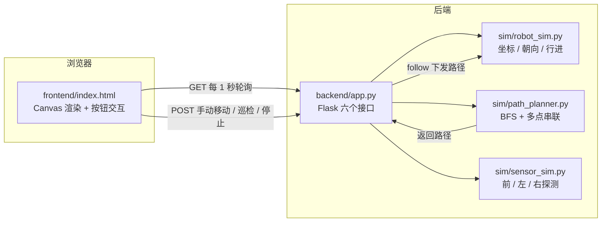

# 03 项目架构与接口

> 本文件是全组唯一口径来源，写定后冻结；改动须全员同意。

## 1. 架构图



## 2. 模块职责

| 模块 | 文件 | 职责 | 不做什么 |
|---|---|---|---|
| 全栈 | `backend/app.py`、`frontend/index.html` | 接口编排、静态页托管、渲染与请求 | 不写业务算法 |
| 嵌入式仿真 | `backend/sim/robot_sim.py` | 维护坐标、朝向、状态，逐格行进 | 不寻路、不感知、不碰界面 |
| 算法 | `backend/sim/path_planner.py` | BFS 最短路、多巡检点串联 | 不控制机器人 |
| 人工智能 | `backend/sim/sensor_sim.py` | 前 / 左 / 右探测、碰撞与越界判断 | 不控制机器人、不绘制界面 |
| 运维 | 根目录构建与 CI 文件 | 一命令起服务、CI 自动检查 | 不写业务代码 |

## 3. 数据约定

| 项 | 约定 |
|---|---|
| 坐标原点 | 地图左上角为 (0, 0)，x 向右递增，y 向下递增，单位为「格」 |
| 地图规格 | 20×20 网格，合法坐标 0–19 的整数 |
| 障碍物 | 二维整数坐标列表，如 `[[6,2],[6,3]]`，落在这些格子不可通行 |
| 机器人字段 | `x`、`y` 当前格坐标；`angle` 取 0 右 / 90 下 / 180 左 / 270 上；`status` 取 `idle` / `moving` / `finished` |
| 状态获取 | 前端每 1 秒轮询 `GET /api/robot` 与 `GET /api/sensor`，不使用 WebSocket |
| 巡检点上限 | 6 个，点击地图添加，再次点击移除 |

## 4. 对外接口

| 用途 | 方法与路径 | 请求示例 | 成功响应 | 失败响应 |
|---|---|---|---|---|
| 取地图 | `GET /api/map` | 无 | `200 {"size":20,"obstacles":[[6,2]],"start":[0,0],"max_patrol_points":6}` | — |
| 取机器人状态 | `GET /api/robot` | 无 | `200 {"x":0,"y":0,"angle":0,"status":"idle"}` | — |
| 手动控制 | `POST /api/move` | `{"direction":"up"}` | `200 {"ok":true}` | `409 {"ok":false,"msg":"前方 (0, -1) 越出地图边界"}` |
| 启动巡检 | `POST /api/patrol` | `{"points":[[3,4],[15,5]],"speed":1}` | `200 {"ok":true,"plan":[[0,0],...],"unreachable":[],"msg":""}` | `409 {"ok":false,"msg":"目标点不可达"}` |
| 停止巡检 | `POST /api/stop` | 无 | `200 {"ok":true,"status":"idle"}` | — |
| 传感器读数 | `GET /api/sensor` | 无 | 见下 | — |

`GET /api/sensor` 返回：

```json
{
  "front_blocked": false,
  "left_blocked": false,
  "right_blocked": false,
  "collision": false,
  "out_of_bound": false,
  "progress": {"finished": 0, "total": 2, "remain": 27},
  "target": [3, 4],
  "status": "moving"
}
```

`progress.finished` 为已到达巡检点数，`progress.total` 为本次巡检点总数，`progress.remain` 为剩余格数；`target` 为当前目标巡检点，无任务时为 `null`。

### 4.1 错误约定

- 手动移动被障碍或边界拦截：HTTP 409，`msg` 写明目标格与原因。
- 巡检点越界、位于障碍物上、格式错误、超过 6 个：HTTP 409，`msg` 写明原因。
- 全部巡检点不可达：HTTP 409，`msg` 为「目标点不可达」。
- 部分巡检点不可达：仍返回 200，`unreachable` 列出被跳过的点，`msg` 说明已跳过。

## 5. 三个仿真模块的内部契约

```python
# backend/sim/robot_sim.py
robot_sim.set_map(obstacles, size)        # 注入地图，后端启动时调用一次
robot_sim.move(direction)   -> dict       # 成功 {"ok": True}；失败 {"ok": False, "msg": 原因}，坐标不变
robot_sim.get_state()       -> dict       # {"x": int, "y": int, "angle": int, "status": str}
robot_sim.follow(points, speed) -> None   # 按点位序列行进，内部线程推进，调用即返回
robot_sim.stop()            -> None
robot_sim.reset()           -> None       # 回到起点，测试与复位使用

# backend/sim/path_planner.py
path_planner.bfs(size, obstacles, start, end) -> dict
    # {"ok": True,  "path": [[x, y], ...], "msg": ""}
    # {"ok": False, "path": [],            "msg": "无法找到路径"}
path_planner.patrol(size, obstacles, points)  -> list
    # 串联后的完整路径（list 子类，附带 unreachable_points 属性）

# backend/sim/sensor_sim.py
sensor_sim.detect(state, obstacles, size=20) -> dict
    # {"front_blocked": bool, "left_blocked": bool, "right_blocked": bool,
    #  "collision": bool, "out_of_bound": bool}
    # 输入非法时额外带 "msg"，各项为 False，不抛异常
```

## 6. 关键行为约定

1. **巡检修途中收到手动指令**：`robot_sim.move` 内部先 `stop()`，再移动一格。
2. **巡检起点**：后端把机器人当前位置放在 `patrol()` 的 `points[0]`，其后为巡检点。
3. **碰撞 / 越界的来源**：`robot_sim` 自我拦截；`sensor_sim` 提供实时读数，前端据此弹窗。
4. **状态口径**：`moving` 仅表示正在按路径行进；手动移动完成后回到 `idle`；巡检走完置为 `finished`。
